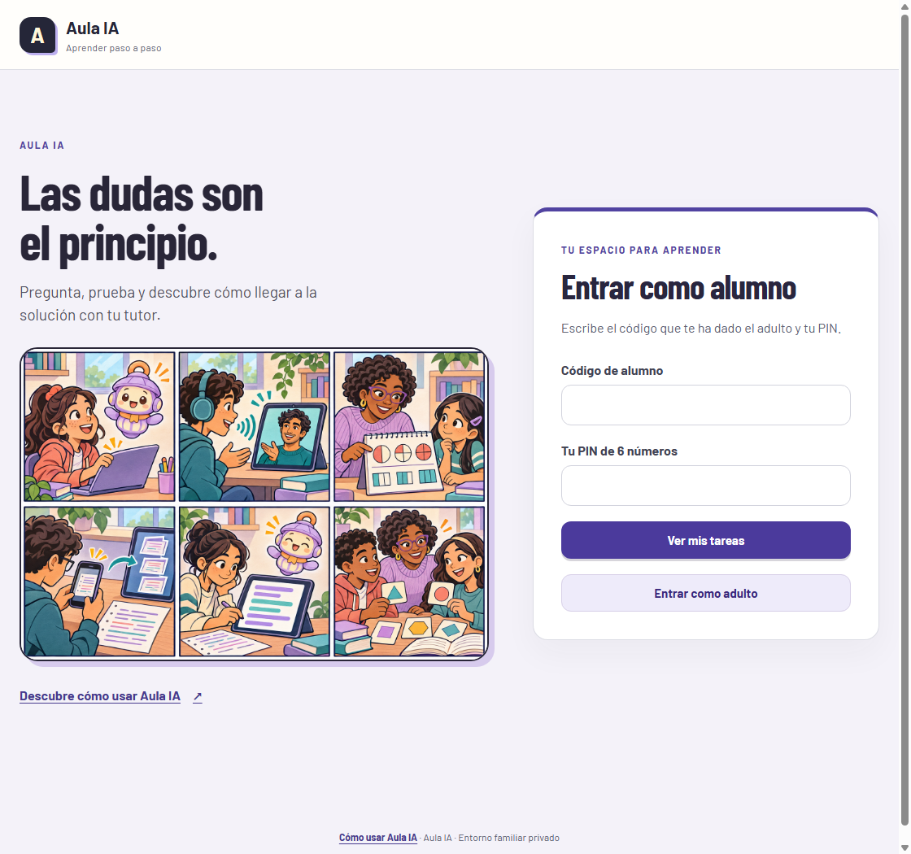
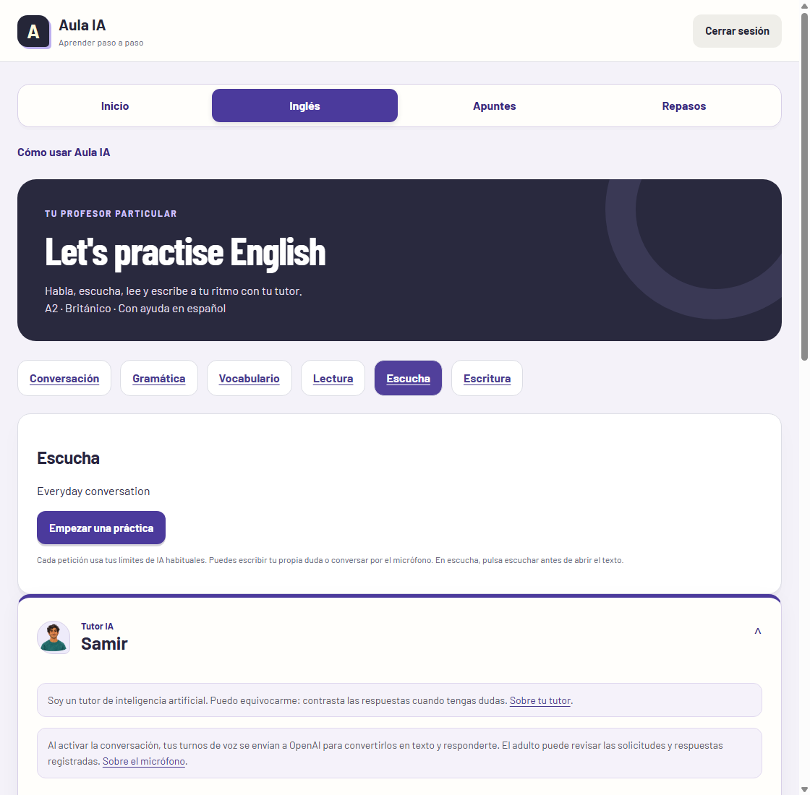
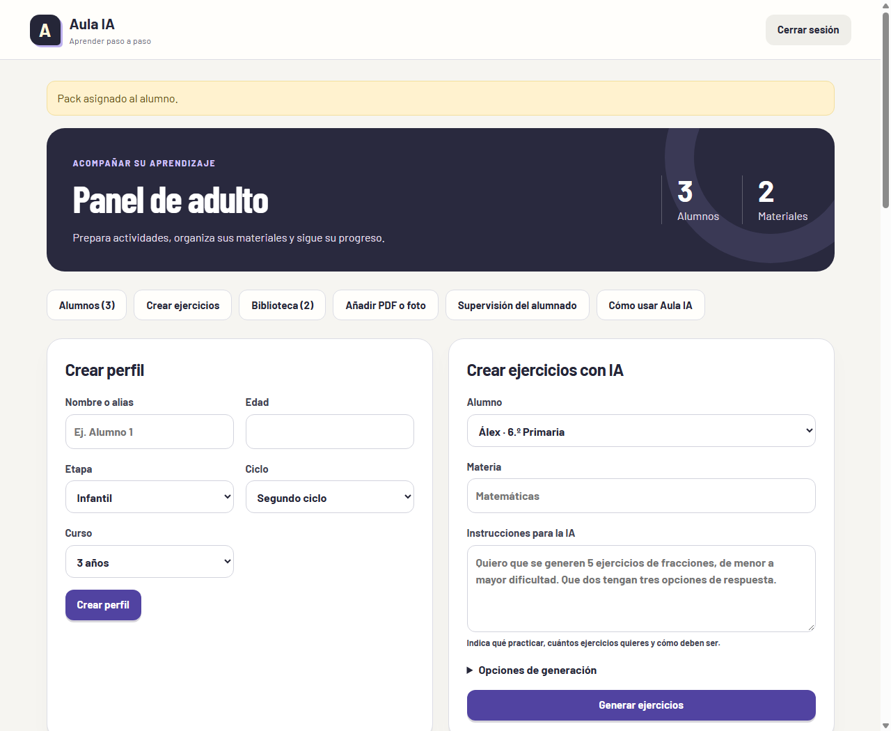
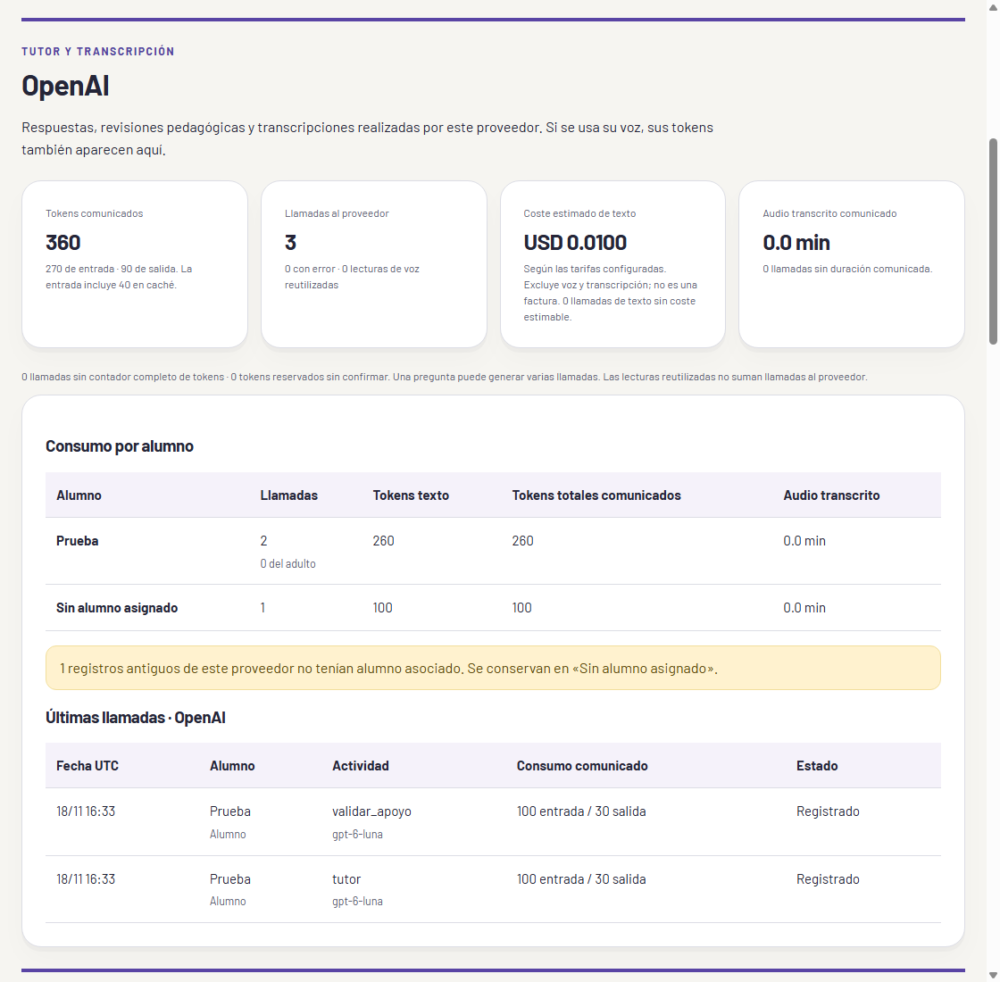
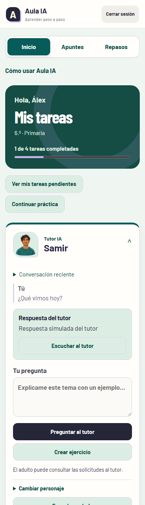

# Aula IA

Tutor educativo familiar que ayuda a comprender, practicar y razonar paso a paso. Adaptado a Infantil, Primaria, ESO y Bachillerato, con supervisión del adulto.

**Versión actual: 1.4.1.** Proyecto en evolución; las respuestas y el OCR deben revisarse cuando existan dudas.



## Inglés especializado

Modo de inglés por alumno, con nivel orientativo, conversación, lectura, escucha, escritura, gramática y vocabulario. Voces británicas o americanas y ayuda opcional en castellano. [Uso e instalación](docs/MODO_INGLES.md).



[Pronunciación básica y escucha dinámica](docs/PRONUNCIACION_Y_ESCUCHA.md): activación del adulto, grabaciones de hasta 20 segundos y límites locales compartidos.

## Para el alumno

- Acceso individual mediante código y PIN.
- Tutores Lumo, Nora y Samir, con personaje guardado entre sesiones y voz adaptada a la edad.
- Conversación escrita y por micrófono, con detección de pausas e interrupción de la voz del tutor.
- Ejercicios con espacio de respuesta, pistas, correcciones e historial de actividades creadas por el tutor.
- Notas de lo aprendido en clase y repasos por materia y fechas, para preparar exámenes.
- Subida de varias fotos o PDF en ESO y Bachillerato, desde cámara o archivos, con revisión del texto extraído.
- Manual interactivo en `/ayuda` y PDF descargable en `/ayuda/pdf`.
- Información familiar de privacidad, cookies y uso de IA en `/privacidad`, con avisos junto al micrófono y los archivos.
- Prueba opcional de voces Azure es-ES: [configuración y guía del recurso gratuito F0](docs/PRUEBA_AZURE_VOZ.md).

El tutor actúa como apoyo: explica dudas, enseña métodos y propone práctica. Las peticiones para sustituir tareas o lecturas se redirigen pedagógicamente y quedan registradas. La revisión con IA no garantiza que todos los intentos de eludir esas reglas se detecten.

## Para el adulto

- Perfiles por edad, etapa, ciclo y curso; códigos de acceso y PIN.
- Generación de ejercicios mediante instrucciones libres y materiales de referencia.
- Revisión, bloqueo y eliminación de apuntes del alumnado.
- Auditoría de solicitudes y límite diario de IA por alumno, incluida su pausa.
- Historial, seguimiento y estimación de consumo del proveedor.
- [Consumo total y por alumno](docs/CONSUMO_Y_LIMITES.md), con secciones independientes de OpenAI y Azure, avisos y bloqueo configurable de presupuestos de texto.







Las capturas proceden de pruebas locales con perfiles y respuestas simuladas.

## Instalación

Requisitos: VM Linux con Docker Engine y Compose. Orientación inicial: 2 vCPU, 4 GB de RAM y espacio para materiales y copias.

1. Copiar `.env.example` a `.env` y definir contraseñas y un secreto de sesión aleatorios.
2. Mantener coherente la contraseña de PostgreSQL en `POSTGRES_PASSWORD` y `DATABASE_URL`.
3. Configurar OpenAI o un servidor Ollama privado. La voz del tutor requiere la configuración de OpenAI.
4. Crear `data/uploads` y `backups`, asignando `data` al UID 10001 del contenedor.
5. Ejecutar `docker compose up -d --build` y comprobar `/health`.

Procedimiento completo: [instalación en Proxmox](docs/INSTALACION_PROXMOX.md). Para publicar mediante HTTPS y proxy, seguir [Publicación en Internet](docs/PUBLICACION_INTERNET.md). El puerto 8000 debe quedar restringido al proxy y a administración; PostgreSQL y Ollama no deben exponerse.

## Seguridad y dependencias

Las instalaciones Docker utilizan `requirements.lock`, con versiones exactas y huellas de integridad. El contenedor se ejecuta sin privilegios y con límites de recursos. La aplicación comprueba CSRF, sesiones, propiedad de los datos, tamaños, cuotas de IA y almacenamiento de adjuntos.

La revisión del 18 de noviembre de 2026 corrigió dos problemas de consumo de recursos. La consulta de los 36 paquetes resueltos para Linux no devolvió vulnerabilidades conocidas en esa fecha. Consultar el [alcance, cambios y limitaciones](docs/REVISION_SEGURIDAD_20261118.md); no equivale a certificar la instalación publicada.

No subir `.env`, claves, bases de datos, apuntes reales ni copias de seguridad. Las nuevas copias usan permisos privados. Los archivos PDF descargados siguen siendo documentos externos: no se incorpora antivirus.

## Desarrollo y versiones

- `main`: versión estable.
- `develop`: preparación de la próxima versión.
- `codex/<mejora>`: ramas temporales para cambios concretos.
- Etiquetas `vX.Y.Z` y una entrega de GitHub por versión: mayor para incompatibilidades, menor para funciones y parche para correcciones.

Cada mejora debe actualizar [CHANGELOG.md](CHANGELOG.md) y `VERSION`, superar las comprobaciones y publicarse como una nueva versión. Esta carpeta no tenía historial propio de Git; `v1.0.0` conserva el estado actual como punto de partida, sin inventar versiones anteriores.

Pruebas locales, tras instalar las dependencias:

```sh
python tests/security_regression.py
```

La prueba usa una base SQLite temporal y respuestas de IA simuladas. Las comprobaciones de GitHub incluyen estas pruebas y una consulta de vulnerabilidades de las dependencias. Antes de publicar una entrega, validar también el contenedor Linux, OCR y PostgreSQL.
