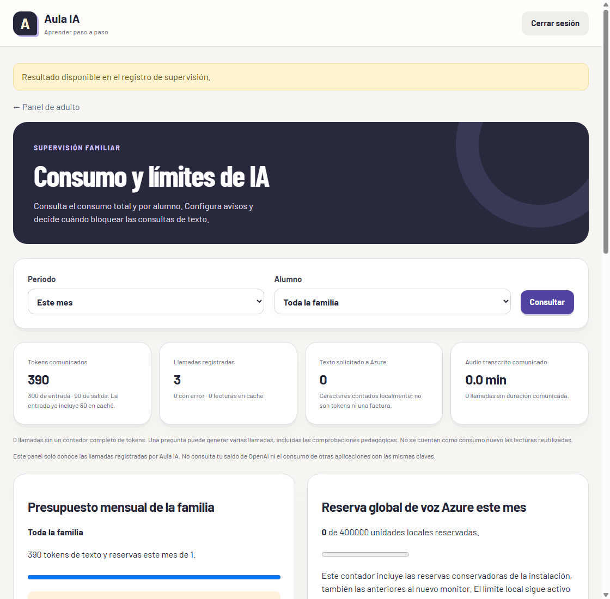
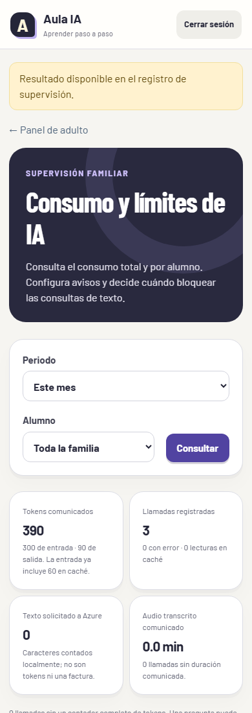

# Consumo y límites de IA · Aula IA 1.2.0

El adulto accede desde **Panel de adulto → Consumo y límites de IA** (`/consumo`). El alumno no tiene acceso a los datos de consumo de otros perfiles ni puede modificar presupuestos.





## Qué muestra

- Periodos: mes actual, hoy en UTC, últimos siete días y todo el histórico; filtro por alumno.
- Tokens de entrada y salida comunicados por el proveedor. Los tokens de entrada en caché son un subconjunto de la entrada y no se vuelven a sumar. La salida puede incluir razonamiento u otros tokens que el modelo comunique, aunque no aparezcan como texto visible.
- Llamadas por perfil, distinguiendo las realizadas por el adulto para ese alumno. Una pregunta puede generar varias llamadas, incluida la revisión pedagógica o un reintento.
- Voz Azure: caracteres del texto solicitado y contador global de reservas locales. Son unidades diferentes de los tokens y de los caracteres facturados por Azure.
- Transcripción: duración y/o tokens cuando el proveedor los comunica. Un contador ausente aparece como desconocido, no como un cero medido.
- Lecturas reutilizadas de la base de datos o de la caché de saludos, sin contarlas como una nueva llamada al proveedor.
- Coste estimado de texto según las tarifas configuradas en el momento de la llamada. No incluye voz ni transcripción; no es el saldo ni la factura del proveedor.

Los registros de consumo no duplican preguntas, respuestas ni grabaciones: almacenan perfil, actor, proveedor, modelo, actividad, fecha, estado y contadores. La supervisión pedagógica existente conserva su propio registro.

## Avisos y bloqueo configurable

Se puede establecer un presupuesto mensual de **tokens de texto** para toda la familia y otro para cada alumno. Un valor de **0** deja ese presupuesto sin configurar. Por defecto no se establece un nuevo bloqueo: el adulto decide el presupuesto y marca si desea bloquear o solo recibir avisos.

El panel avisa al 80 %, al 95 % y al alcanzar el presupuesto. El presupuesto familiar se aplica también a las actividades del adulto; el presupuesto de un alumno incluye las llamadas del adulto dirigidas a ese perfil. Los presupuestos usan meses naturales UTC; las cuotas diarias de peticiones existentes mantienen su horario de Madrid.

Antes de una llamada de texto se reserva un margen conservador: tamaño en bytes del texto de entrada, margen de formato y máximo de salida solicitado. La reserva se registra y se comprueba bajo bloqueo de presupuesto antes de contactar al proveedor. Al llegar los contadores, se sustituye por el consumo comunicado. La salida está acotada por `AI_MAX_OUTPUT_TOKENS` (4096 por defecto) o `AI_MAX_GENERATION_TOKENS` (12000 para generar grupos/materiales).

Por eso una consulta puede bloquearse **antes de agotar los tokens medidos**, si no queda margen para reservar una respuesta completa. Un presupuesto demasiado pequeño puede impedir la primera consulta. Se puede observar primero el consumo con avisos y después activar el bloqueo con un margen adecuado. Los contadores desconocidos o una interrupción de conexión conservan la reserva incierta hasta finalizar el mes; el adulto puede ampliar el presupuesto o desactivar ese bloqueo si necesita continuar. Un rechazo HTTP 4xx confirmado libera su reserva. Si el presupuesto bloquea la petición antes de cualquier llamada, no consume la cuota diaria pedagógica del alumno.

El presupuesto de texto no limita por sí mismo tokens de voz o duración de audio. Se mantienen los controles específicos ya existentes: límite diario de peticiones por alumno, límite no reembolsable de transcripciones, límite de generaciones de voz y reserva mensual local de Azure.

## Histórico y cuota del proveedor

Los registros anteriores de `AIUsage` se conservan. Como no tenían alumno asociado, aparecen en **Sin alumno asignado** y cuentan para el total familiar cuando corresponda. No es posible reconstruir con fiabilidad su distribución por alumno ni llamadas antiguas que no se registraron.

La atribución detallada y los nuevos contadores de audio empiezan al instalar 1.2.0. El contador global de reserva Azure existente sí se conserva e incluye las reservas previas. No debe confundirse con una lectura del saldo o cuota real de Microsoft: otras aplicaciones pueden consumir usando la misma clave. Este monitor tampoco consulta el saldo de OpenAI ni el uso externo del proyecto.

Referencias: [contadores y límites de tokens de OpenAI](https://developers.openai.com/api/docs/guides/token-counting), [uso de voz y transcripción](https://developers.openai.com/api/docs/guides/voice-latency-cost), [facturación de texto a voz Azure](https://learn.microsoft.com/en-us/azure/ai-services/speech-service/text-to-speech).

## Instalar

El parche es acumulativo y conserva las credenciales y la región de Azure de `.env`. Subir `Aula_IA_parche_v1.2.0.tar.gz` a `/tmp` y ejecutar:

```sh
cd /opt/proyecto-aula-ia &&
bash scripts/backup.sh &&
copia="backups/codigo-antes-v1.2.0-$(date +%Y%m%d-%H%M%S)" &&
mkdir -p "$copia" &&
cp -a app requirements.txt Dockerfile docker-compose.yml scripts "$copia/" &&
if [ -f requirements.lock ]; then cp -a requirements.lock "$copia/"; fi &&
tar -xzf /tmp/Aula_IA_parche_v1.2.0.tar.gz &&
docker compose build --pull web &&
docker compose up -d --no-deps web &&
docker compose ps web
```

Al arrancar se crean dos tablas nuevas de consumo y presupuestos. No se alteran las columnas de las tablas existentes ni se borran sus registros. Un retorno al código anterior puede dejar esas tablas sin utilizar; no se recomienda borrarlas ni restaurar una base antigua sin revisar las actividades creadas después.

Después de instalar, abrir `/consumo`, comprobar el histórico y hacer una consulta corta con un alumno. Las llamadas y sus revisiones deben aparecer en su fila. Probar primero un presupuesto en modo aviso y después el bloqueo según el uso deseado. No hace falta cambiar las claves, el proveedor de voz ni el dominio.

## Validación y límites de la revisión

Se prueban con SQLite y proveedores simulados la atribución, los contadores desconocidos, errores, histórico, contabilidad sin duplicados, permisos/CSRF, presupuestos, reservas pendientes y bloqueo previo a las llamadas. Se conservan las regresiones de voz Azure y conversación. Los bloqueos de presupuesto de PostgreSQL se implementan con filas bloqueadas y orden común familiar/perfil; no se dispone de Docker local para repetir el recorrido en PostgreSQL o reconstruir la imagen.

La comprobación local no equivale a verificar la facturación real del proveedor ni el servidor publicado. Conviene contrastar inicialmente las cifras con los portales de OpenAI y Azure.
