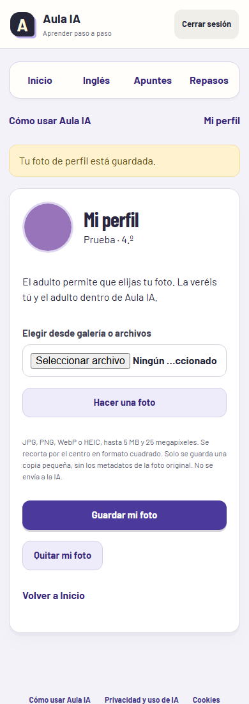

# Foto de perfil · Aula IA 1.6.0

## Autorizar desde el adulto

Abrir **Panel de adulto → Perfiles de alumnos → Configurar → Foto de perfil**. Marcar **Permitir que [alumno] ponga su foto de perfil** y pulsar **Guardar permiso de foto**. El permiso empieza desactivado para todos los perfiles y se configura por alumno, en cualquier etapa.

El adulto puede ver la foto actual y usar **Eliminar foto del alumno**. Esto elimina la imagen conservando el permiso para que pueda elegir otra. Si desmarca el permiso y guarda, se elimina la imagen actual y se impiden nuevas subidas. Se registran los cambios de permiso, foto y eliminación en supervisión.

## Elegir la foto desde el alumno

1. Entrar con el código y PIN habituales y abrir **Mi perfil**, junto al acceso de ayuda o desde Inicio.
2. Si el adulto lo ha permitido, usar **Elegir desde galería o archivos** o **Hacer una foto**. En móvil/tableta se solicita la cámara frontal si el navegador lo admite; en ordenador se puede elegir un archivo.
3. Revisar la vista previa y pulsar **Guardar mi foto**. Se recorta por el centro en un cuadrado. Si el navegador no puede mostrar una vista previa HEIC, el servidor puede comprobar y convertir el archivo al guardarlo.
4. La foto aparece en **Mi perfil** y **Inicio**. **Quitar mi foto** la elimina y vuelve a mostrar la inicial del nombre.

Formatos permitidos: JPG, PNG, WebP y HEIC estáticos. Máximo de 5 MB y 25 megapíxeles. Si la imagen es demasiado grande, elegir una versión reducida. Un archivo inválido conserva la foto anterior. Hay un límite técnico de seis intentos de subida por hora y alumno, independiente del límite de IA.

## Privacidad y almacenamiento

Se guarda una única copia JPEG de 320 × 320 píxeles, de hasta 128 KiB, sin EXIF ni los demás metadatos originales. El original no se conserva en el almacenamiento de la aplicación. La foto no se envía a OpenAI, Azure ni otros servicios de IA y no consume tokens.

La imagen solo se sirve al alumno propietario o al adulto con sesión válida. No aparece en el acceso público ni se muestra a otros alumnos. La ruta de imagen comprueba los permisos y se entrega con caché desactivada. Las copias de seguridad anteriores pueden contener una imagen ya eliminada hasta retirar esas copias.

## Instalar y comprobar

Aplicar **Aula_IA_parche_v1.6.0.tar.gz** siguiendo los [pasos del parche acumulativo](PRONUNCIACION_Y_ESCUCHA.md#instalar-el-parche-acumulativo). Se crea la tabla `profile_photos` sin modificar las columnas existentes. La imagen reducida queda en la base de datos familiar y entra en las copias habituales de esa base.

Después de instalar, probar permiso desactivado, autorización, subida, visualización desde el alumno y el adulto, eliminación y retirada del permiso. Usar imágenes de prueba para esta comprobación.

Pruebas locales con SQLite: permisos, CSRF, aislamiento, formato y tamaño reales, metadatos, sustitución segura, retirada del permiso durante la conversión y límite de frecuencia. Navegador con cuatro anchos, vista previa y selección mediante los dos controles. No se ha desplegado en el servidor del usuario ni probado una cámara física, todos los modelos de móvil, Docker o PostgreSQL locales.
