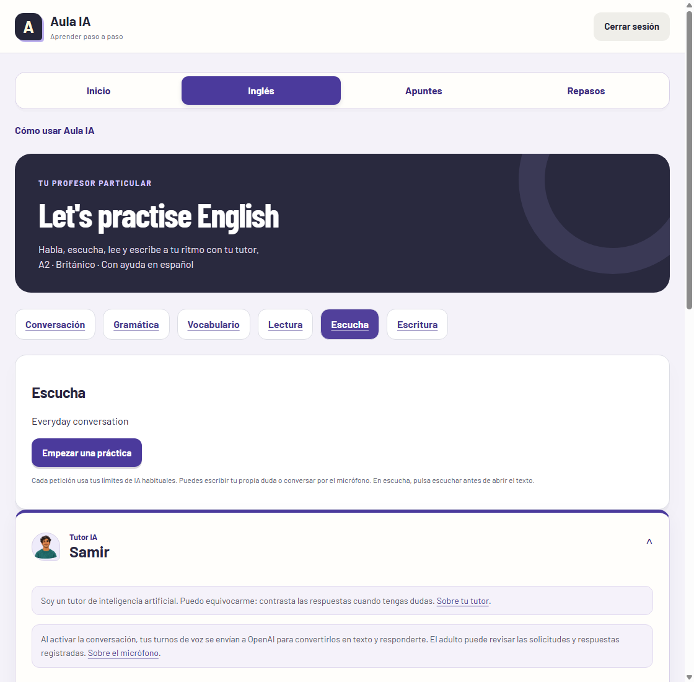
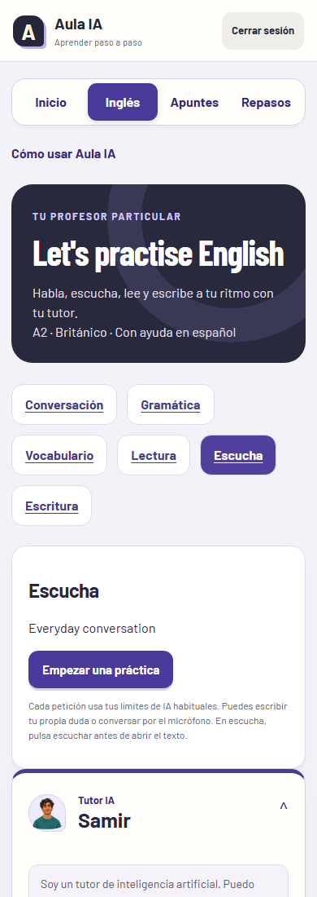
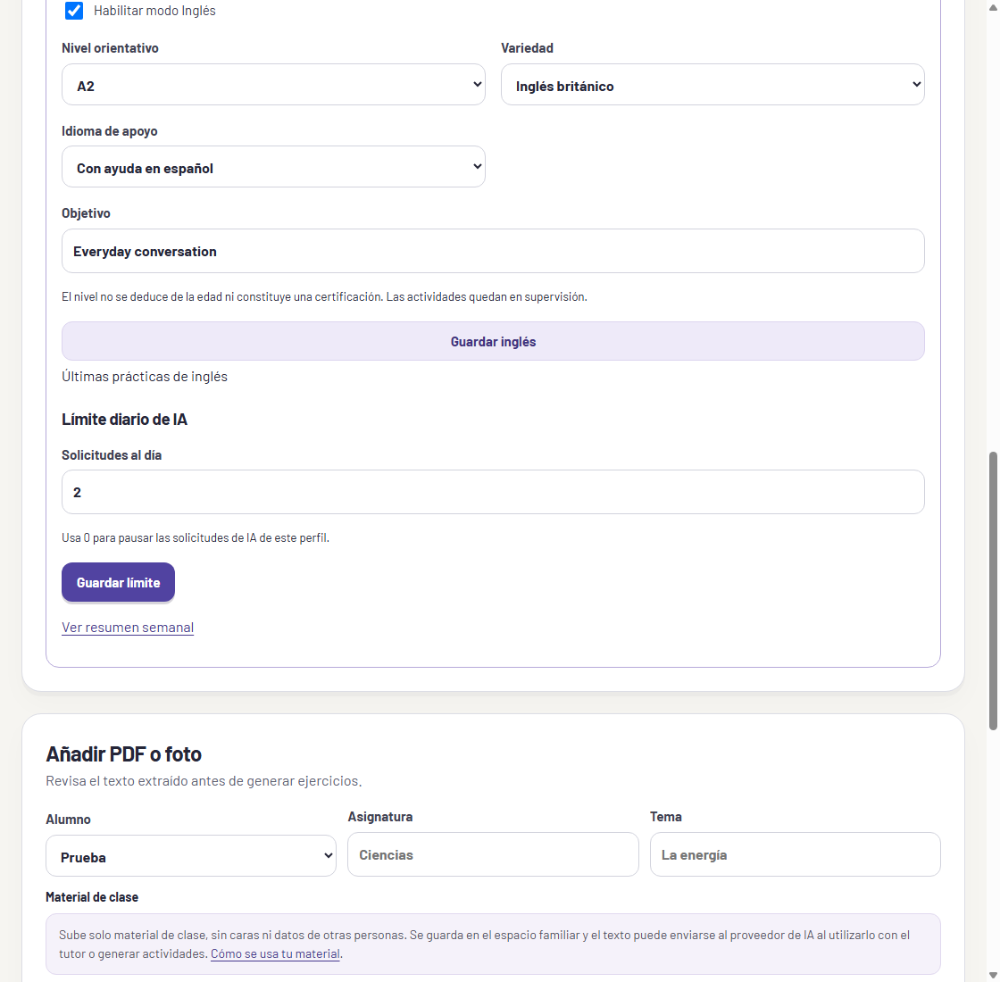

# Inglés especializado · Aula IA 1.3.0

El modo Inglés usa el personaje y el acceso del alumno que ya existen. Se añade a las demás materias, sin otra cuenta ni otra web.





## Preparar el perfil

En **Panel de adulto → Perfiles de alumnos → Configurar → Profesor de inglés**:

1. Habilitar el modo Inglés.
2. Elegir el nivel orientativo: por valorar, Pre-A1 o A1–C2. No se calcula automáticamente por edad o curso. Con «Por valorar», el tutor empieza con actividades sencillas y adapta sus propuestas; el adulto conserva el control del nivel guardado.
3. Elegir inglés británico o americano, ayuda en castellano o solo inglés y un objetivo breve.
4. Guardar. Las nuevas prácticas usarán estos ajustes; no cambian retroactivamente los textos y grabaciones anteriores.

No es una prueba oficial de nivel ni una certificación. Se aceptan variantes británicas y americanas correctas, aunque se indique una variedad de referencia.



## Para el alumno

Entrar en **Inglés** desde su menú y elegir Conversación, Gramática, Vocabulario, Lectura, Escucha o Escritura. «Empezar una práctica» pide una propuesta al tutor; también puede escribir una duda propia, pedir un ejercicio o conversar por el micrófono.

En conversación se proponen turnos breves. En escritura se espera el intento del alumno y se le guía para autocorregirse. Para lectura y escucha se pide material original adecuado al nivel. En escucha, usar «Escuchar al tutor» antes de abrir «Ver el texto de escucha». Se trata de escucha generada por IA, no de un examen con audio externo validado.

La respuesta de práctica está en inglés. Cuando el adulto habilita la ayuda, aparece aparte en español y puede escucharse con voz española. Durante una conversación la ayuda también se muestra en pantalla; el turno inglés se reproduce automáticamente mediante los controles existentes. Los avisos de silencio o ruido siguen siendo españoles.

Las instrucciones especializadas se aplican también a las dudas sobre ejercicios de Inglés, su corrección y generación, y los repasos cuyo material seleccionado sea íntegramente de Inglés. Un repaso con asignaturas mezcladas conserva el comportamiento general.

## Seguimiento y supervisión

Se guardan turnos por habilidad, palabras practicadas y observaciones generadas por el tutor. Son un registro de trabajo, no una prueba de dominio ni una nota. El alumno ve sus últimas prácticas y el adulto ve las recientes en su configuración y las solicitudes en supervisión. Las ayudas y observaciones se someten a la revisión pedagógica antes de mostrarse y guardarse.

El tutor mantiene las reglas de apoyo: explicar, preguntar, proponer ejemplos distintos y guiar al alumno. No debe hacer sus entregas ni sustituir una lectura. Como toda clasificación con IA, esta protección no garantiza detectar todos los intentos de elusión.

## Voz y consumo

Se utiliza el proveedor de voz ya configurado. Para Azure se conservan las voces españolas y se añaden estas voces inglesas regionales:

| Personaje | Británico | Americano |
|---|---|---|
| Lumo | en-GB-LibbyNeural | en-US-JennyNeural |
| Nora | en-GB-SoniaNeural | en-US-AriaNeural |
| Samir | en-GB-RyanNeural | en-US-GuyNeural |

Se pueden probar en **Probar las voces del tutor → Idioma de prueba**. La disponibilidad debe comprobarse con el recurso y región del servidor. No se ha hecho ninguna llamada facturable durante las pruebas locales.

Si el proveedor falla, el respaldo del dispositivo exige el mismo idioma exacto: es-ES, en-GB o en-US. Si no hay una voz instalada, se informa y queda la lectura en pantalla. No se sustituye automáticamente una voz inglesa por castellano. La voz OpenAI recibe instrucciones de acento; la voz regional Azure es la opción específica seleccionada para el recurso actual.

Cada firma y caché distingue el idioma. El alumno no puede cambiar el idioma firmado ni la configuración de otro perfil. Se mantienen los límites diarios compartidos, presupuestos de texto, límites de transcripción y límite mensual global de voz Azure. El monitor sigue separando OpenAI de Azure; aprender inglés no crea cuotas gratuitas adicionales.

**Desde 1.4.0**, el adulto puede habilitar [Pronunciación básica](PRONUNCIACION_Y_ESCUCHA.md) con Azure y límites propios. La conversación habitual sigue siendo una transcripción, sin evaluación fonética. En Escucha, el tutor reproduce automáticamente el nuevo turno tras proponer la práctica, sujeto a las restricciones de audio del navegador.

Referencias: [descriptores MCER](https://www.coe.int/en/web/common-european-framework-reference-languages/cefr-descriptors), [voces Azure](https://learn.microsoft.com/en-us/azure/ai-services/speech-service/language-support), [evaluación específica de pronunciación](https://learn.microsoft.com/en-us/azure/ai-services/speech-service/how-to-pronunciation-assessment).

## Instalar el parche acumulativo

Subir `Aula_IA_parche_v1.3.0.tar.gz` a `/tmp` del servidor y ejecutar:

```sh
cd /opt/proyecto-aula-ia &&
bash scripts/backup.sh &&
copia="backups/codigo-antes-v1.3.0-$(date +%Y%m%d-%H%M%S)" &&
mkdir -p "$copia" &&
cp -a app requirements.txt Dockerfile docker-compose.yml scripts "$copia/" &&
if [ -f requirements.lock ]; then cp -a requirements.lock "$copia/"; fi &&
tar -xzf /tmp/Aula_IA_parche_v1.3.0.tar.gz &&
docker compose build --pull web &&
docker compose up -d --no-deps web &&
docker compose ps web
```

Se crean `english_preferences` y `english_turns` al arrancar. No se alteran columnas anteriores ni se sobrescribe `.env`, las claves o la región de Azure. Conservar la copia de seguridad; no restaurar una base anterior sin revisar las actividades posteriores. Un retorno al código anterior puede dejar las tablas nuevas sin utilizar.

Después de instalar, configurar un perfil, probar una voz inglesa y hacer una práctica corta. Verificar el idioma, ayuda, historial y atribución en consumo. La prueba en servidor y la calidad de las voces/modelo reales no quedan certificadas por las comprobaciones locales.

## Comprobaciones

Pruebas con SQLite y proveedores simulados de permisos/CSRF, aislamiento por perfil, nivel y variedad, pausas, revisión pedagógica, seguimiento, contrato de corrección, conversación y firmas/cachés por idioma. Se mantienen las regresiones de seguridad, consumo y Azure; revisión visual en Chrome a 320, 390, 768 y 1120 píxeles.

Sin Docker ni PostgreSQL locales y sin pruebas de pronunciación ni medición de calidad lingüística con el proveedor real. No se ha desplegado el parche en el servidor del usuario.
