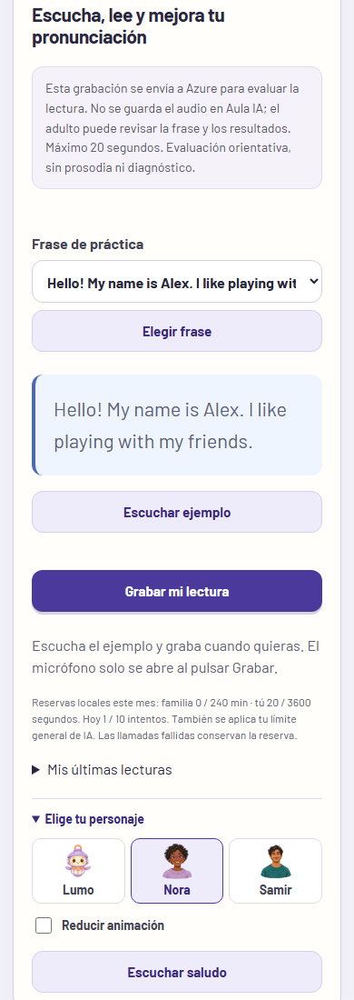
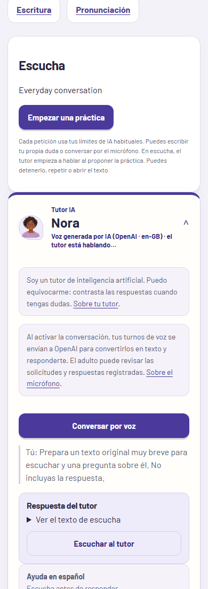

# Pronunciación y Escucha · Aula IA 1.5.0

## Activar la pronunciación

El adulto entra en el panel principal, abre **Pronunciación** y activa la evaluación familiar. Después revisa la autorización y los límites de cada alumno. El alumno entra en **Inglés → Pronunciación**, elige una frase, escucha el ejemplo y pulsa **Grabar**. Al terminar, detiene la grabación para evaluarla. Cancelar antes del envío no solicita una evaluación.

La función familiar está desactivada inicialmente. Utiliza la clave y región del recurso Azure Speech ya configurado: para esta instalación, North Europe y F0. No cambia el nivel de precios, no crea recursos y no habilita la evaluación adicional de prosodia. Si Azure rechaza la petición, se muestra un aviso sin reintentar automáticamente.

Límites iniciales:

| Ámbito | Límite |
| --- | --- |
| Cada grabación | 20 segundos |
| Familia | 240 minutos por mes |
| Alumno | 60 minutos por mes y 10 intentos al día |

El adulto puede ajustar los límites de la aplicación, hasta 240 minutos mensuales y 30 intentos diarios por alumno. También se aplica el límite general de peticiones de IA del alumno. Los periodos se calculan en UTC. El límite familiar se comparte entre todos los alumnos y se reserva antes de contactar con Azure, incluso con peticiones simultáneas.

La reserva usa segundos redondeados hacia arriba. Un error o una respuesta no reconocida conserva la reserva y el intento: Azure podría haber procesado el audio. Un rechazo por límites de pronunciación, previo al envío, devuelve la reserva de la petición general de IA. El panel diferencia consumo confirmado y tiempo reservado; estos contadores locales no son una lectura del saldo de Azure.

El margen de 240 minutos es una precaución local, no una garantía de gratuidad: el recurso puede tener otros consumidores. Revisar sus cuotas y consumo en Azure antes de activarlo. La voz del ejemplo consume caracteres de síntesis por separado. No se cambia automáticamente a un plan de pago.

## Qué evalúa y qué conserva

Se envía a Azure únicamente un audio corto y la frase de referencia del catálogo del servidor. El navegador convierte la grabación a WAV PCM mono de 16 kHz y 16 bits; el servidor comprueba duración, formato y tamaño de nuevo. No se aceptan frases de referencia arbitrarias ni se guarda el audio en la base de datos o en archivos de la aplicación.

Se conservan alumno, fecha, frase, duración, estado y resultados filtrados para el seguimiento del adulto. Las puntuaciones de precisión, fluidez, completitud y resultado general aparecen solo si las devuelve Azure. Son orientativas, no una calificación oficial ni un diagnóstico. En inglés británico se presenta información por palabra; en inglés estadounidense también pueden mostrarse los sonidos de referencia devueltos por Azure. No se inventa una transcripción fonética de lo que ha pronunciado el alumno.

Esta evaluación no utiliza otra transcripción de OpenAI ni otra llamada al tutor para interpretar las puntuaciones. En **Consumo** se separan OpenAI, caracteres de voz Azure y segundos de evaluación Azure. La conversación habitual continúa funcionando como conversación y transcripción, sin atribuirle una evaluación fonética.

## Escucha más dinámica

En **Inglés → Escucha**, elegir uno de los tres niveles relativos y pulsar **Empezar listening**. Se crea el ejercicio y el tutor intenta iniciar el audio al abrirlo. La pregunta queda visible para responder. El adulto elige por alumno si el pasaje puede verse o permanece solo en audio.

El mismo botón permite detener y repetir; si el navegador exige un toque, el alumno usa **Escuchar / repetir**. El micrófono requiere activación expresa. Hay una estrategia de ayuda y se pueden consultar dudas sobre la pregunta. Los listening antiguos que no separan pregunta y pasaje se sustituyen por una práctica nueva cuando el adulto oculta el texto.

[Guía completa de niveles, permisos y ayuda de Listening](LISTENING.md).

## Instalar el parche acumulativo

Subir `Aula_IA_parche_v1.5.0.tar.gz` a `/tmp` del servidor y ejecutar:

```sh
cd /opt/proyecto-aula-ia &&
bash scripts/backup.sh &&
copia="backups/codigo-antes-v1.5.0-$(date +%Y%m%d-%H%M%S)" &&
mkdir -p "$copia" &&
cp -a app requirements.txt Dockerfile docker-compose.yml scripts "$copia/" &&
if [ -f requirements.lock ]; then cp -a requirements.lock "$copia/"; fi &&
tar -xzf /tmp/Aula_IA_parche_v1.5.0.tar.gz &&
docker compose build --pull web &&
docker compose up -d --no-deps web &&
docker compose ps web
```

No se incluye ni se sobrescribe `.env`. Se crean las tablas `pronunciation_policies` y `pronunciation_attempts` al arrancar; no se alteran columnas anteriores. Conservar las copias y no restaurar una base antigua sin revisar las actividades posteriores. Volver al código previo deja estas tablas sin utilizar.

Tras instalar, probar una frase corta con un perfil de prueba y verificar el resultado y la atribución del consumo. Comprobar también Escucha en los móviles y tabletas de la familia.

## Comprobaciones y límites





Pruebas locales con SQLite y proveedores simulados: permisos, CSRF, aislamiento, formatos, límites compartidos simultáneos, errores sin reintentos, contabilidad separada, respuesta firmada y reproducción del nuevo turno una sola vez. Pruebas de navegador de reproducción automática, grabación, cancelación y visualización móvil.

No se ha desplegado esta versión en el servidor del usuario. No se ha realizado una petición facturable real a Azure ni se han comprobado su saldo F0, la calidad fonética real o PostgreSQL y Docker locales.

Referencias: [evaluación de pronunciación](https://learn.microsoft.com/en-us/azure/ai-services/speech-service/how-to-pronunciation-assessment), [API de audio corto](https://learn.microsoft.com/en-us/azure/ai-services/speech-service/rest-speech-to-text-short) y [precios de Speech](https://azure.microsoft.com/en-us/pricing/details/speech/).
